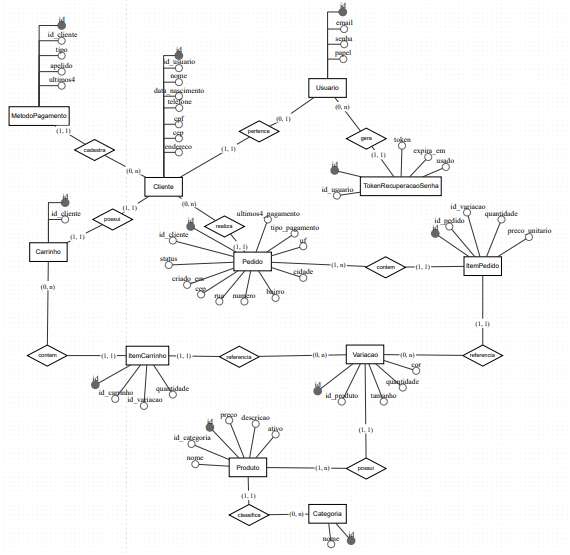

# API E-COMMERCE New Style - Back-End
API de uma e-commerce de uma loja de roupas (New Style), desenvolvida em Django Rest Framework.


## 📋 Sobre o Projeto

A API atende uma loja virtual de roupas, com uma única loja (New Style). O lojista pode administrar o catálogo e os pedidos, os clientes podem navegar, montam o próprio carrinho e finalizam as comprar, e os visitantes podem somente navegar. O pagamente é simulado, sem integração com gateway.

## 🚀 Tecnologias Utilizadas

### Core

- **Django 6.1.2** - Framework web principal
- **Django Rest Framework 3.18.3** - Framework para construção de API REST

### Utilitários

- **django-cors-headers** - Libera o acesso da API para o front-end (CORS)
- **python-decouple** - Leitura das variáveis de ambiente do arquivo `.env`
- **django-filter** - Filtros combináveis nas listagens


## 📁 Estrutura do Projeto

```
Ecommerce-API/
├── accounts/                  # usuários, clientes e recuperação de senha
│   ├── management/commands/   # criar_lojista (seed)
│   ├── migrations/
│   ├── models.py
│   ├── permissions.py         # EhLojista e EhCliente 
│   ├── serializers.py
│   ├── validators.py          # Regra de senha forte
│   └── views.py
├── assets/ 
│   └── DER_Ecommerce.png
├── cart/                      # carrinho e itens
├── catalog/                   # categorias, produtos e variações
│   ├── management/commands/   # criar_categorias (seed)
│   └── ...
├── orders/                    # pedidos e métodos de pagamento
│   ├── services.py            
│   └── ...
├── setup/                     # Configurações do Django
│   ├── exceptions.py          # formato padronizado de erro
│   ├── settings.py
│   └── urls.py                
├── docs/                      
├── .env.example               # Modelo das variáveis de ambiente
├── requirements.txt           # Dependências Python
├── manage.py
└── README.md
```
## 🗂 Modelagem

### Diagrama Entidade-Relacionamento (DER)

O diagrama Entidade e Relacionamento foi feito no BrModelo.



### Decisões de modelagem

- **Usuario** separado de **Cliente**. O Usuario vai guardar o login. O lojista existe somente como Usuario, sem dados de cliente, e é criado via seed.
- Chave primária **id** em todas em entidades.
- O **ItemCarrinho** referente a variação, não o produto
- O estoque fica na **Variacao**, não no produto. Produtos de tamanho único usam a variação **Único**.
- Nada é exluído do catálogo. Os produtos são apenas desativados e variações saem de venda zerando o seu estoque. 

## ⚙️ Configuração e Instalação

### Pré-requisitos

- Python 3.12+

### 1. Clone o Repositório

```bash
git clone [link]
cd Ecommerce-API
```

### 2. Configuração do Ambiente Virtual

```bash
# Windows
python -m venv venv
venv\Scripts\activate

# Linux/Mac
python -m venv venv
source venv/bin/activate
```

### 3. Instalação das Dependências

```bash
pip install -r requirements.txt
```

### 4. Variáveis de Ambiente

Copie o arquivo de exemplo e ajuste os valores se necessário:

```bash
# Windows
copy .env.example .env

# Linux/Mac
cp .env.example .env
```

### 5. Migrações do Banco

```bash
python manage.py makemigrations
python manage.py migrate
```

### 6. Criação do Superusuário

```bash
python manage.py createsuperuser
```

### 7. Seed: Lojista e Categoria

```bash
python manage.py criar_lojista
python manage.py criar_categorias
```

### 8. Execução do Servidor

```bash
python manage.py runserver
```

O servidor estará disponível em `http://127.0.0.1:8000/`.


| Rota        | Descrição                             |
|-------------|---------------------------------------|
| `/docs/`    | Swagger (Documentação da API)         |
| `/admin/`   | Painel administrativo do Django       |
| `/schema/`  | Esquema OpenAPI                       |


### Variáveis de Ambiente para Produção

```bash
DEBUG=False
ALLOWED_HOSTS=seu-dominio.com
SECRET_KEY=chave-super-secreta-para-producao
LOJISTA_EMAIL=email-do-lojista
LOJISTA_SENHA=senha-forte-do-lojista
```

Para gerar uma `SECRET_KEY` nova:

```bash
python -c "from django.core.management.utils import get_random_secret_key; print(get_random_secret_key())"
```

### Padrões de Código

- **PEP 8** para formatação Python
- **Docstrings** para funções e classes
- **Português** para nomes de domínio (models, campos, serializers, views), mantendo em inglês o que é sintaxe do framework (`Meta`, `ForeignKey`, `Serializer`...)
- **Regras de negócios** ficam em `services.py` e permissões por papel em `accounts/permissions.py` 

## 📖 Documentação da API

### Swagger

Com o servidor ja rodando, abra o `/docs`. Todos os endpoints estão descritos no sistema, com exemplos de corpo de requisição e agrapuados por suas seções.

#### Como testar as rotas protegidas:

- Faça `POST/auth/login` pelo swagger e copio o valor de `access`.
- Clique em **Authorize** e cole o token.
- Todas as próximas chamadas vão com o token. Para trocar de usuário, basta dar Logout na janela e colar outro token de usuário.

### Endpoints

As rotas não têm barra final, a paginação usa `?page=` (10 itens por página)

| Método      | Rota                                         | Acesso              |
|-------------|----------------------------------------------|---------------------|
| POST        |   `/auth/register`                           |   Público           |
| POST        |   `/auth/login`                              |   Público           |
| POST        |   `/auth/forgot-password`                    |   Público           |
| POST        |   `/auth/reset-password`                     |   Público (token)   |
| GET         |   `/categories`                              |   Público           |
| GET         |   `/products`                                |   Público           |
| GET         |   `/products/{id}`                           |   Público           |
| POST        |   `/products`                                |   Lojista           |
| PUT         |   `/products/{id}`                           |   Lojista           |
| POST        |   `/products/{id}/variations`                |   Lojista           |
| PUT         |   `/products/{id}/variations/{variationId}`  |   Lojista           |
| GET         |   `/cart`                                    |   Cliente           |
| POST        |   `/cart/items`                              |   Cliente           |
| PUT         |   `/cart/items/{id}`                         |   Cliente           |
| DELETE      |   `/cart/items/{id}`                         |   Cliente           |
| POST        |   `/orders`                                  |   Cliente           |
| GET         |   `/orders`                                  |   Cliente/Lojista   |
| GET         |   `/orders/{id}`                             |   Cliente/Lojista   |
| PATCH       |   `/orders/{id}/status`                      |   Lojista           |
| POST        |   `/payment-methods`                         |   Cliente           |
| GET         |   `/payment-methods`                         |   Cliente           |
| DELETE      |   `/payment-methods/{id}`                    |   Cliente           |

## Autenticação e permissões

- Rotas protegidas exigem `Authorization: Bearer <token>`
- Sem o token válido, a resposta é 401
- O cadastro sempre cria um cliente: o campo papel, se enviado, é ignorado
- O login sempre com letras minúsculas no email
- O cliente pode somente acessar o próprio carrinho, pedidos e métodos de pagamento.

## Filtros de produtos

`GET /products?category=&min_price=&max_price=&search=&status=&page=`

| Parâmetro                  | Descrição                                          |
|----------------------------|----------------------------------------------------|
| `category`                 | O id da categoria                                  |
| `min_price` e ` max_price` | A faixa de preço                                   |
| `search`                   | Buscar pelo nome (sem diferenciação de maiúsculas) |
| `status`                   | `active` ou `inactive` (somente lojista)           |
| `page`                     | Número da página                                   |

- Os filtros são combináveis 
- Visitantes e clientes podem ver somente os próprios produtos
- Produto inativo consultado por cliente e visitante retorna 404